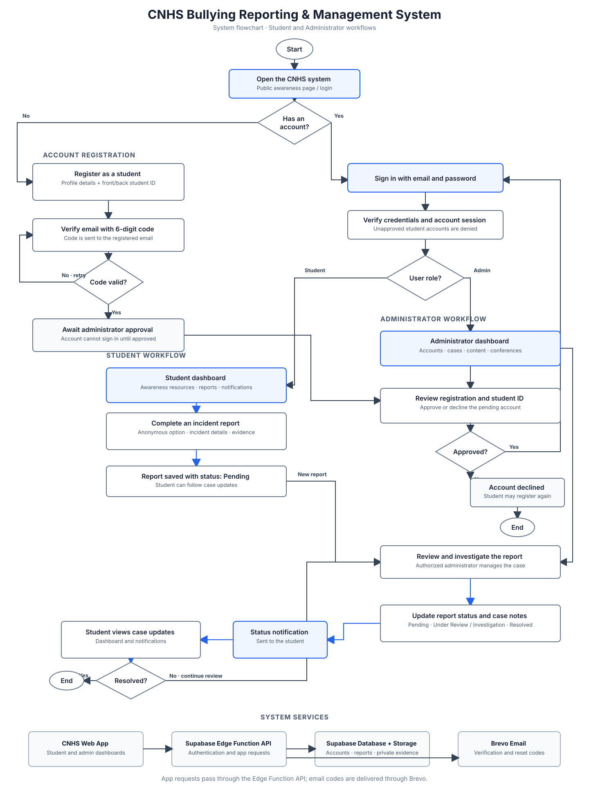

# CNHS Bullying & Incident Reporting System

## System flowchart

[Open the editable draw.io diagram](./system-flowchart.drawio) in diagrams.net or import it into draw.io.

## Entity relationship diagram

[Open the editable database ERD](./system-erd.drawio) in diagrams.net or import it into draw.io.

## Level 1 data flow diagram

[Open the editable Level 1 DFD](./system-dfd-level-1.drawio) in diagrams.net or import it into draw.io.

## Development

1. Copy `.env.example` to `.env` and set `VITE_SUPABASE_URL` and `VITE_SUPABASE_ANON_KEY` from your Supabase project.
2. Run `npm install`.
3. Run `npm run dev`.

Authentication and database access run in the Supabase Edge Function; Brevo delivers email verification and password-reset codes. The Vite server only serves the frontend. Never place the Supabase service-role key, Brevo key, or session secret in a `VITE_` variable.

## Existing Supabase project

Run [`supabase/custom_auth.sql`](./supabase/custom_auth.sql) once in the Supabase SQL Editor before deploying this version. It keeps existing student/admin IDs and records but detaches them from Supabase Auth. Existing student/admin profiles must use **Forgot Password** to verify their email and set a new password; pending legacy sign-ups without a student profile must register again. Supabase Auth passwords cannot be exported.

For a new database, run [`supabase/schema.sql`](./supabase/schema.sql) instead. It recreates the application tables and must not be run on a database containing data you want to keep.

For an existing database, run [`supabase/grade_section_advisers.sql`](./supabase/grade_section_advisers.sql) in the Supabase SQL Editor to enable section adviser assignments. Existing sections will be marked unassigned until an admin edits them.

For media storage, run [`supabase/media_storage.sql`](./supabase/media_storage.sql) once in the SQL Editor. Back up the project first, then set `SUPABASE_URL` and `SUPABASE_SERVICE_ROLE_KEY` in your local environment and run `npm run migrate:media` to move existing inline report evidence and awareness images into Storage. The service-role key is required only for this local migration command; never expose it in the frontend or commit it. The migration keeps evidence private and creates optimized awareness thumbnails where possible.

Report evidence is loaded only when a student or admin chooses to view it, which avoids downloading proof files just by opening a case. Newly attached images are resized and compressed to WebP before upload.

Articles are no longer supported in the Awareness Hub. To permanently remove existing article entries and their stored media from Supabase, back up the project, set `SUPABASE_URL` and `SUPABASE_SERVICE_ROLE_KEY` locally, then run `npm run remove:articles`.

## Deployment

After applying the media SQL and migrating existing files, configure the Edge Function secrets in Supabase, link the Supabase CLI to your project, and deploy the `api` function with `supabase functions deploy api`. Redeploy this function whenever its code changes; the student proof-reply action is not available until the updated function is deployed. Deploy the frontend to Vercel or another static host with `VITE_SUPABASE_URL` and `VITE_SUPABASE_ANON_KEY`. See [`supabase/ADMIN_SETUP.md`](./supabase/ADMIN_SETUP.md) for the exact steps, required secrets, and admin setup.
